<div align="center">


<a href="https://github.com/RehimMammadov">
  
</a>

<br/><br/>


<br/><br/>

<a href="https://rahimmammadov.dev/"></a>
<a href="https://www.linkedin.com/in/rahim-mammadov-a79991269/"></a>
<a href="mailto:rehim.m04@gmail.com"></a>

</div>


## 🧠 About Me

<table width="100%">
<tr>
<td width="50%" valign="top">

```ts
const rahim: Developer = {
  location: "Baku, Azerbaijan 🇦🇿",
  role: "Frontend / Full Stack Developer",
  currentWork: "Qala Insurance — Frontend Dev",
  stack: {
    core:    ["React", "Vue", "TypeScript", "Next.js"],
    state:   ["Zustand", "Redux Toolkit", "TanStack Query"],
    testing: ["Jest", "Vitest", "RTL", "Playwright"],
    backend: ["PHP", "Laravel", "Django", "NestJS"],
    ci_cd:   ["GitHub Actions", "Docker", "Vercel"],
  },
  learning: ["System Design", "GraphQL", "a11y"],
  funFact: "I automate things twice — once to " +
           "save time, once for fun.",
};
```

</td>
<td width="50%" valign="top">

**🔭 Currently Working On**<br/>
Frontend systems for an enterprise insurance platform — CMS, authentication, and payment flows at Qala Insurance.

**🌱 Currently Learning**<br/>
Next.js App Router, GraphQL, system design, end-to-end testing, and accessibility.

**🎯 Goal**<br/>
Grow into a **Senior Full Stack Engineer**, deepening architecture skills while staying hands-on with the frontend.

**💡 Interests**<br/>
Design systems, developer tooling, performance engineering, and test automation.

**⚡ Philosophy**<br/>
The best code is the code you never had to write — and the code you did write should be tested.

</td>
</tr>
</table>

## 💼 Experience

<table width="100%">
<tr>
<td width="14%" align="center" valign="middle">

<br/><sub><b>Nov 2025 —<br/>Jul 2026</b></sub>
</td>
<td width="86%">

### Frontend Developer · **Qala Insurance**

Built and maintained core customer-facing modules for an enterprise **insurance platform**, combining **React** and **Vue** SPAs with **PHP / Laravel Blade** server-rendered pages.

- ⚡ Delivered high-performance, responsive UI for policy management, claims, and customer dashboards
- 🔐 Implemented secure **authentication** flows and integrated **payment processing**
- 🗃️ Managed complex client state with **Redux** and typed API layers in **TypeScript**
- 🚀 Improved Core Web Vitals through **Vite** code-splitting and asset optimization
- 🎨 Built a consistent, responsive design language with **Tailwind CSS**

    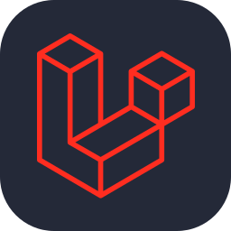   

</td>
</tr>
<tr>
<td width="14%" align="center" valign="middle">

<br/><sub><b>Jul 2024 —<br/>Jul 2026</b></sub>
</td>
<td width="86%">

### Frontend Developer · **Qala Life Insurance**

<!-- TODO: replace these bullets with achievements specific to this role -->
Developed customer-facing features for a **life insurance** web platform using **React**, **Vue**, and **TypeScript** alongside **Laravel Blade** templates.

- 🧩 Built reusable, responsive UI components for policy and customer self-service flows
- 🔐 Contributed to authentication and online payment integrations
- 🔌 Connected frontend features to internal **REST APIs** and CMS-driven content
- 🧱 Integrated interactive components into **Blade** views for a hybrid SSR + SPA setup
- 📈 Reduced bundle size and load times with **Vite** and **Tailwind** purging

       

</td>
</tr>
<tr>
<td width="14%" align="center" valign="middle">
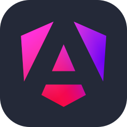
<br/><sub><b>Feb 2024 —<br/>May 2024</b></sub>
</td>
<td width="86%">

### Frontend Developer · **GoldenPay OJSC**

Worked on the web interfaces of **GoldenPay**, an Azerbaijani online payment provider, building merchant- and customer-facing features in **Angular**.

- 💳 Developed payment-flow screens with a focus on clarity, validation, and error handling
- 🧩 Built modular Angular components and services with **TypeScript** and **RxJS**
- 📝 Implemented reactive forms with robust client-side validation for transaction data
- 📱 Delivered responsive, cross-browser layouts with **Bootstrap** and **SCSS**
- 🔌 Integrated frontend modules with backend payment and reporting APIs

  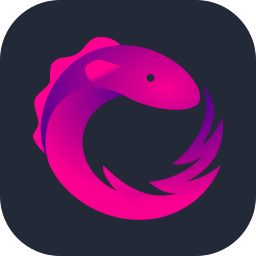  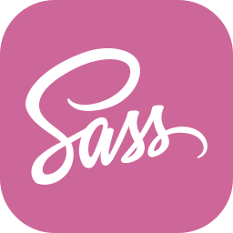  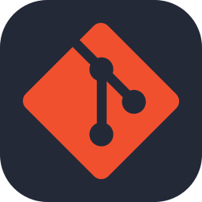

</td>
</tr>
<tr>
<td width="14%" align="center" valign="middle">

<br/><sub><b>Sep 2023 —<br/>Feb 2024</b></sub>
</td>
<td width="86%">

### Full-Stack Developer · **Bamper Az (Startup)**

Early full-stack engineer at **Bamper Az**, a startup where I owned features end-to-end — from database models to UI to deployment.

- 🏗️ Built backend features, models, and admin tools with **Python** and **Django**
- 🎨 Developed responsive, server-rendered pages with **HTML**, **CSS**, and **JavaScript**
- 🐳 Containerized the application with **Docker** for consistent dev and production environments
- 🌐 Configured **Nginx** as a reverse proxy and static file server for production
- 🚀 Shipped fast in a small team, turning product ideas into working features within days

   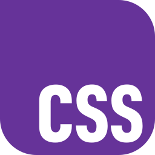    

</td>
</tr>
</table>

## 🛠️ Tech Stack

<table width="100%">
<tr>
<td width="22%" align="center"><b>🎨 Frontend Core</b></td>
<td>         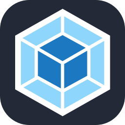 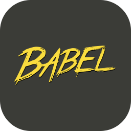</td>
</tr>
<tr>
<td width="22%" align="center"><b>🗃️ State & Data</b></td>
<td>    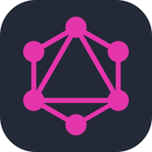   </td>
</tr>
<tr>
<td width="22%" align="center"><b>💅 Styling & UI</b></td>
<td>  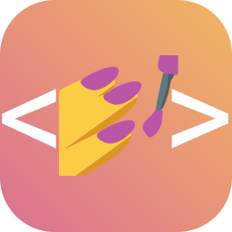 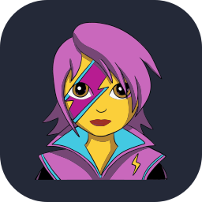       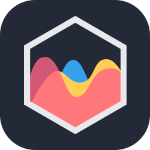</td>
</tr>
<tr>
<td width="22%" align="center"><b>🧪 Testing</b></td>
<td>      </td>
</tr>
<tr>
<td width="22%" align="center"><b>🔄 CI/CD & DevOps</b></td>
<td>    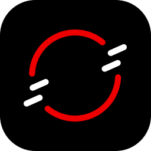    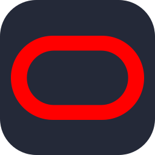   </td>
</tr>
<tr>
<td width="22%" align="center"><b>⚙️ Backend</b></td>
<td>          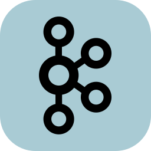 </td>
</tr>
<tr>
<td width="22%" align="center"><b>🗄️ Databases</b></td>
<td>   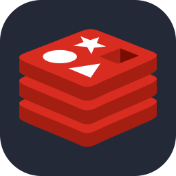 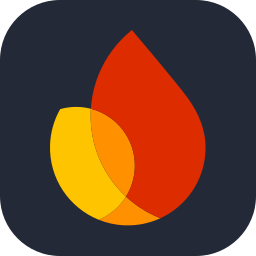   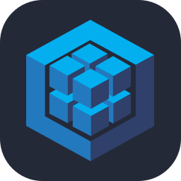</td>
</tr>
<tr>
<td width="22%" align="center"><b>🧰 Tools & Quality</b></td>
<td>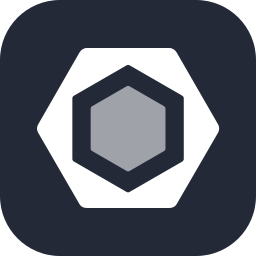 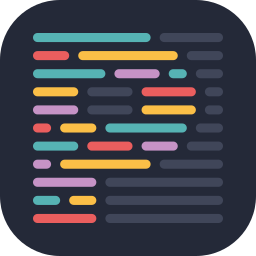   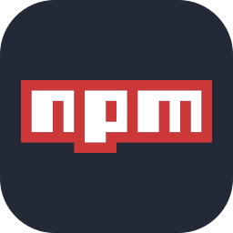 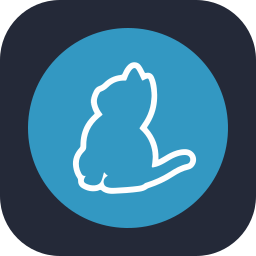   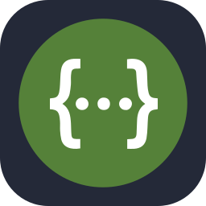   </td>
</tr>
</table>

## 🔁 How I Ship

<div align="center">
<table>
<tr>
<td align="center"><br/><sub>Commit</sub></td>
<td align="center">➜</td>
<td align="center"><br/><sub>Lint</sub></td>
<td align="center">➜</td>
<td align="center"><br/><sub>Type-check</sub></td>
<td align="center">➜</td>
<td align="center"><br/><sub>Unit</sub></td>
<td align="center">➜</td>
<td align="center"><br/><sub>E2E</sub></td>
<td align="center">➜</td>
<td align="center"><br/><sub>Build</sub></td>
<td align="center">➜</td>
<td align="center"><br/><sub>Deploy</sub></td>
</tr>
</table>
</div>

<table width="100%">
<tr>
<td width="33%" valign="top" align="center">

**🧪 Unit & Integration**<br/>
<sub>Jest · Vitest · React Testing Library · MSW — testing behavior, not implementation details</sub>

</td>
<td width="33%" valign="top" align="center">

**🎭 End-to-End**<br/>
<sub>Playwright · Cypress — critical user flows like login, checkout, and payments</sub>

</td>
<td width="33%" valign="top" align="center">

**🚦 Automated Pipelines**<br/>
<sub>GitHub Actions — every PR is linted, type-checked, tested, and previewed</sub>

</td>
</tr>
</table>

## 🚀 Featured Projects

<table width="100%">
<tr>
<td width="50%" valign="top">


**E-commerce Dashboard** &nbsp;

Admin dashboard for orders, inventory, and analytics with real-time charts and role-based access.

   

<a href="https://github.com/RehimMammadov/ecommerce-dashboard"></a>
<a href="#"></a>

</td>
<td width="50%" valign="top">


**Insurance Platform** &nbsp;

Enterprise insurance web platform: policy management, claims, CMS, authentication, and payments.

   


</td>
</tr>
<tr>
<td width="50%" valign="top">


**Real-time Chat App** &nbsp;

Full-stack messaging app with rooms, typing indicators, and message history over WebSockets.

   

<a href="https://github.com/RehimMammadov/realtime-chat"></a>
<a href="#"></a>

</td>
<td width="50%" valign="top">


**Component Library** &nbsp;

Accessible React component library with Storybook docs, theming, and full test coverage.

    

<a href="https://github.com/RehimMammadov/component-library"></a>
<a href="#"></a>

</td>
</tr>
<tr>
<td width="50%" valign="top">


**Task Manager** &nbsp;

Task management with real-time boards and team workspaces, server state via TanStack Query and UI state via Zustand.

    

<a href="https://github.com/RehimMammadov/task-manager"></a>
<a href="#"></a>

</td>
<td width="50%" valign="top">


**Booking Web App** &nbsp;

Appointment booking with calendar sync, email reminders, an admin panel, and Playwright E2E coverage.

   

<a href="https://github.com/RehimMammadov/booking-app"></a>
<a href="#"></a>

</td>
</tr>
<tr>
<td width="50%" valign="top">


**CMS Starter Kit** &nbsp;

Headless CMS-driven starter for blogs, marketing pages, and docs — out of the box.

  

<a href="https://github.com/RehimMammadov/cms-starter-kit"></a>
<a href="#"></a>

</td>
<td width="50%" valign="top">


**Developer Portfolio** &nbsp;

Minimal, fast, animated portfolio built with a design-system-first approach.

  

<a href="https://github.com/RehimMammadov/developer-portfolio"></a>
<a href="#"></a>

</td>
</tr>
</table>

## 📊 GitHub Analytics

<!--
  These widgets use free, shared community services and may occasionally show a
  rate-limit error. See docs/CUSTOMIZATION.md → "Fixing broken or rate-limited stats"
  for a self-hosted fix.
-->

<div align="center">


</div>

## 💻 Most Used Languages

<div align="center">

<!-- Generated daily by .github/workflows/languages.yml (no external service needed) -->
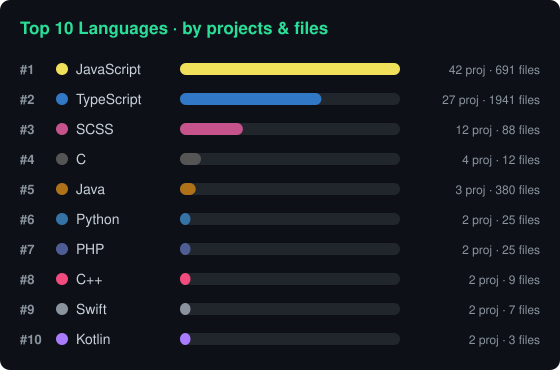

</div>

<!-- WakaTime: see docs/CUSTOMIZATION.md to enable the waka.yml workflow -->
<!--START_SECTION:waka-->
<!--END_SECTION:waka-->

<!--START_SECTION:activity-->
<!--END_SECTION:activity-->

## 🐍 Contribution Snake

<div align="center">
<picture>
  <source media="(prefers-color-scheme: dark)" srcset="https://raw.githubusercontent.com/RehimMammadov/RehimMammadov/output/github-contribution-grid-snake-dark.svg?v=2" />
  <source media="(prefers-color-scheme: light)" srcset="https://raw.githubusercontent.com/RehimMammadov/RehimMammadov/output/github-contribution-grid-snake.svg?v=2" />
  
</picture>
<br/>
<sub>🐍 Every green square is a day of commits, and the snake eats them all · updates every 12 hours</sub>
</div>

<div align="center">

<br/>

> *"The best way to predict the future is to build it."* — **Alan Kay**

## 🤝 Let's Connect

<a href="https://github.com/RehimMammadov"></a>
<a href="https://www.linkedin.com/in/rahim-mammadov-a79991269/"></a>
<a href="mailto:rehim.m04@gmail.com"></a>
<a href="https://rahimmammadov.dev/"></a>

</div>


<div align="center">
<sub>⭐ From <b>Rahim Mammadov</b> — built with care, tested with intent, shipped through CI.</sub>
</div>
